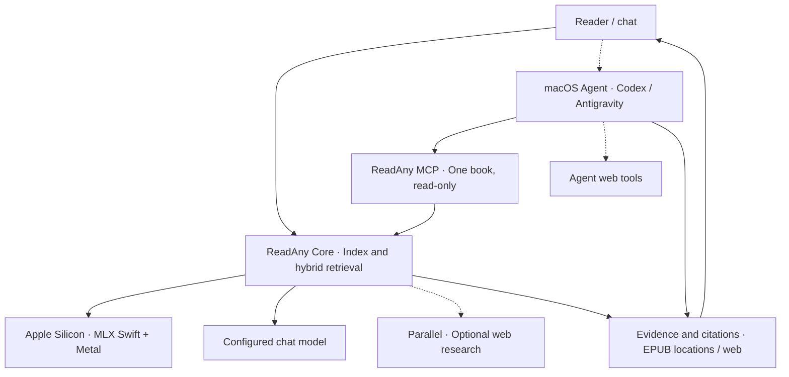

  

<h1 align="center">ReadAny-MLX</h1>

<strong>Local-first AI Reading &amp; Research for Apple Silicon</strong> 面向 Apple Silicon 的 AI 阅读与研究工作台

  
  
  
  

  <a href="README.md">中文</a> · <a href="#downloads">Downloads</a> · <a href="#quick-start">Quick start</a> · <a href="docs/mlx/README.md#english">Documentation</a>

ReadAny-MLX is an unofficial open-source fork of [ReadAny](https://github.com/codedogQBY/ReadAny). Search books with on-device embeddings on iPad and Mac, jump from citations back to an EPUB passage, and bring in web sources or desktop agents when you need them.

> [!IMPORTANT]
> `main` is the default GitHub branch. It holds the upstream base code and documentation portal. **Check out the branch for the MLX edition you want to build.**

## Editions

| iPad Local MLX | macOS Local MLX Base | macOS Agent |
| :--- | :--- | :--- |
| **`mlx-ios`** | **`macos-mlx`** | **`feat/macos-mlx-agents`** |
| Index and search books with on-device MLX on iPad, with optional Parallel web research. | Run local MLX, book retrieval, and built-in web research through ReadAny chat on Mac. | Adds Codex App Server, Antigravity ACP, and read-only, single-book ReadAny MCP to the macOS edition. |
| [Branch and guide](https://github.com/Gnon-Golem/ReadAny-MLX/tree/mlx-ios) · [Download IPA](#downloads) | [Branch](https://github.com/Gnon-Golem/ReadAny-MLX/tree/macos-mlx) · [Build guide](https://github.com/Gnon-Golem/ReadAny-MLX/blob/macos-mlx/docs/macos-mlx.md) | [Branch](https://github.com/Gnon-Golem/ReadAny-MLX/tree/feat/macos-mlx-agents) · [Agent setup](docs/mlx/configuration.md#desktop-agents) |

[`downloads`](https://github.com/Gnon-Golem/ReadAny-MLX/tree/downloads) stores the published iPad IPAs and SHA-256 checksums.

## Screenshots

  

*Upstream ReadAny desktop screenshot showing an EPUB and the built-in AI reading assistant. Edition-specific screenshots of MLX model management, iPad MLX, Codex, and Antigravity are pending.*

## Core features

- **On-device embeddings.** MLX Swift and Metal run Qwen3-Embedding-4B Q8 on Apple Silicon and produce 2,560-dimensional vectors. After the initial model import, book indexing and retrieval work offline.
- **Hybrid book RAG.** Combine BM25 keyword matching with vector similarity. Evidence includes EPUB locations so readers can follow citations back to the original passage.
- **Optional web research.** Built-in ReadAny chat uses Parallel to search and read web pages and can use book and web evidence in the same turn. Web research is off by default. The configured chat model generates answers, and its provider determines where generation runs.
- **Desktop agents.** The Agent edition uses a locally installed, signed-in CLI via Codex App Server or Antigravity ACP. ReadAny MCP grants read-only access to one book per authorized session and returns verifiable citation evidence. The reader sidebar and home view can resume the same session, with separate histories for the two runtimes.

## Feature comparison

| Feature | iPad MLX | macOS MLX | macOS Agent |
| :--- | :---: | :---: | :---: |
| MLX Swift / Qwen3-Embedding-4B Q8 | Yes | Yes | Yes |
| Offline EPUB indexing and BM25, semantic, and hybrid retrieval | Yes | Yes | Yes |
| Built-in AI chat and optional Parallel web research | Yes | Yes | Yes |
| EPUB navigation and web citations | Yes | Yes | Yes |
| Single-book ReadAny MCP, Codex App Server, and Antigravity ACP | — | — | Yes |
| Agent session recovery across reader, home, and restart | — | — | Yes |
| Installation | Published IPA or Xcode build | Build from source | Build from source |

## Architecture

[Platform integration, evidence flow, and network boundaries](docs/mlx/architecture.md#english).

## Installation and quick start

### Downloads

| iPad package | IPA | SHA-256 | Corresponding source |
| :--- | :--- | :--- | :--- |
| 1.3.7 build 2 · Web research | [Download](https://raw.githubusercontent.com/Gnon-Golem/ReadAny-MLX/f577d780ef6a53c4a6fc5b6d781abd7350010481/ReadAny-MLX-1.3.7-build2-research-iOS.ipa) | [Checksum](https://raw.githubusercontent.com/Gnon-Golem/ReadAny-MLX/f577d780ef6a53c4a6fc5b6d781abd7350010481/SHA256SUMS-research.txt) | [`6df597d6`](https://github.com/Gnon-Golem/ReadAny-MLX/tree/6df597d6de8bc83e24395e84eeb38a68fac55982) |
| 1.3.7 build 2 · Local MLX | [Download](https://raw.githubusercontent.com/Gnon-Golem/ReadAny-MLX/4f775c8da29196bd247bb46c1ab112355952ba87/ReadAny-MLX-1.3.7-build2-iOS.ipa) | [Checksum](https://raw.githubusercontent.com/Gnon-Golem/ReadAny-MLX/4f775c8da29196bd247bb46c1ab112355952ba87/SHA256SUMS.txt) | [`328971a1`](https://github.com/Gnon-Golem/ReadAny-MLX/tree/328971a1d9f840e22f0dbce38d61aaf7f764b56e) |

The public IPAs target physical arm64 iPads and require signing for sideloading. Both macOS editions are available as source for arm64 development builds. See the [installation and build guide](docs/mlx/build.md#english).

### Quick start

1. For iPad, verify and sideload an IPA, or check out `mlx-ios` and build with Xcode. On Mac, choose the base or Agent edition and follow the [build guide](docs/mlx/build.md#english).
2. Download and import the [pinned Qwen3 Q8 model](docs/mlx/configuration.md#embedding-model). Load the model, import an EPUB, and index that book.
3. Try searching the book. To generate an answer, configure a chat model and open the AI reading assistant. To add web sources, enable Parallel or select a configured [desktop agent](docs/mlx/configuration.md#desktop-agents).

## Performance and device verification

| Test environment | Observed result |
| :--- | :--- |
| iPad Pro M5 (12 GB), standalone Q8 probe | 100 consecutive 256-token embeddings, with a median of **221 ms** and P95 of **226 ms**. |
| Same iPad, Xcode-signed ReadAny MLX | Offline EPUB indexing, hybrid retrieval, citation navigation, background recovery, and legacy ONNX index checks passed. The application peaked at about **4.44 GiB** in this run. |
| MacBook Air M5 (16 GB), macOS MLX development build | Offline indexing of a short synthetic EPUB, all three retrieval modes, CFI navigation after restart, and live Parallel search passed. |
| Same Mac, Agent development build | Signed-in Codex and Antigravity each completed single-book vector retrieval, native web search, citation navigation, and session recovery after restart. |

These observations cover the specified M5 devices and controlled samples. SideStore installation, refresh, and memory entitlement retention for the public IPAs, other devices, large libraries, and live cross-device WebDAV sync are pending. [Full test conditions and results](docs/mlx/verification.md#english).

## Roadmap

Near-term work covers public IPA installation and refresh, more devices and long EPUBs, reproducible performance results, and four sets of product screenshots. Device compatibility follows observed test results. [Development roadmap](docs/mlx/roadmap.md#english).

## Upstream, credits, and license

Thanks to the [ReadAny team](https://github.com/codedogQBY/ReadAny) for the reader and its base code. This fork retains the upstream attribution **© 2024 ReadAny Team**, Git history, original documentation in [English](README.upstream.md) and [Chinese](README_CN.md), and the [GPL v3 license text](LICENSE). Package metadata declares `GPL-3.0-or-later`. [Upstream website](https://codedogqby.github.io/ReadAny/).

The reader, desktop app, and mobile app build on projects including foliate-js, Tauri, and Expo. Thanks also to Apple MLX and the Qwen model ecosystem. Parallel, Codex, and Antigravity are integrations maintained in this community fork and provided by their respective vendors.
