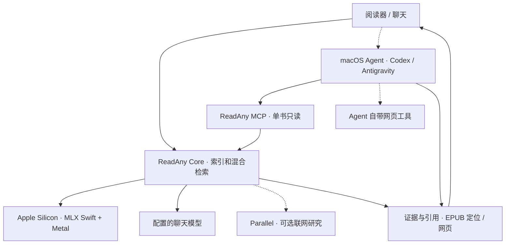

  

<h1 align="center">ReadAny-MLX</h1>

<strong>面向 Apple Silicon 的 AI 阅读与研究工作台</strong> Local-first AI Reading &amp; Research for Apple Silicon

  
  
  
  

  <a href="README.en.md">English</a> · <a href="#下载">下载</a> · <a href="#快速开始">快速开始</a> · <a href="docs/mlx/README.md">文档</a>

ReadAny-MLX 是 [ReadAny](https://github.com/codedogQBY/ReadAny) 的非官方开源 Fork。在 iPad 和 Mac 上用设备内向量模型检索书籍，从回答跳回 EPUB 原文，并按需引入网页资料或桌面 Agent。

> [!IMPORTANT]
> `main` 是 GitHub 默认分支，保留上游基础代码并承载文档门户。**构建 MLX 版本时，请先检出下方对应的产品分支。**

## 产品版本

| iPad 本地 MLX | macOS 本地 MLX 基础版 | macOS 完整 Agent |
| :--- | :--- | :--- |
| **`mlx-ios`** | **`macos-mlx`** | **`feat/macos-mlx-agents`** |
| 在 iPad 上建立本地书籍索引、做语义检索，并可选择开启 Parallel 联网研究。 | 将本地 MLX、书内检索和原生联网研究带到 Mac，适合通过 ReadAny 原生聊天研究书籍。 | 在 Mac 基础版上加入 Codex App Server、Antigravity ACP 和单书只读 ReadAny MCP。 |
| [分支及使用指南](https://github.com/Gnon-Golem/ReadAny-MLX/tree/mlx-ios) · [下载 IPA](#下载) | [分支](https://github.com/Gnon-Golem/ReadAny-MLX/tree/macos-mlx) · [构建指南](https://github.com/Gnon-Golem/ReadAny-MLX/blob/macos-mlx/docs/macos-mlx.md) | [分支](https://github.com/Gnon-Golem/ReadAny-MLX/tree/feat/macos-mlx-agents) · [Agent 配置](docs/mlx/configuration.md#桌面-agent) |

[`downloads`](https://github.com/Gnon-Golem/ReadAny-MLX/tree/downloads) 存放已发布的 iPad IPA 和 SHA-256 校验文件。

## 软件界面

  

*上游 ReadAny 的真实桌面界面，展示 EPUB 与原生 AI 阅读助手。MLX 模型管理、iPad MLX、Codex 和 Antigravity 的专项截图待补。*

## 核心功能

- **设备内向量推理**。Apple Silicon 上通过 MLX Swift 和 Metal 运行 Qwen3-Embedding-4B Q8，输出 2,560 维向量。首次导入权重后，书籍向量化和检索可断网运行。
- **书内混合 RAG**。把 BM25 关键词匹配与向量相似度结合。证据记录包含 EPUB 定位信息，读者可从引用跳回原文。
- **可选联网研究**。ReadAny 原生聊天通过 Parallel 搜索和读取网页，可在同一轮使用本地书籍和网页证据。联网默认关闭。回答生成由你配置的聊天模型负责，其运行位置取决于所选服务。
- **桌面 Agent**。完整 Agent 版通过 Codex App Server 或 Antigravity ACP 接入本机已登录的 CLI。ReadAny MCP 按会话授权一本书，返回只读检索结果和可核对的引用。阅读侧栏和主页可恢复同一会话，两种运行时各自保存历史。

## 功能对比

| 功能 | iPad MLX | macOS MLX | macOS Agent |
| :--- | :---: | :---: | :---: |
| MLX Swift / Qwen3-Embedding-4B Q8 | 支持 | 支持 | 支持 |
| 离线 EPUB 索引、BM25／语义／混合检索 | 支持 | 支持 | 支持 |
| 原生 AI 聊天及可选 Parallel 联网 | 支持 | 支持 | 支持 |
| 书籍定位与网页引用 | 支持 | 支持 | 支持 |
| ReadAny 单书 MCP、Codex App Server、Antigravity ACP | — | — | 支持 |
| 外部 Agent 在阅读侧栏、主页和重启后续聊 | — | — | 支持 |
| 安装方式 | 已发布 IPA 或 Xcode 构建 | 源码构建 | 源码构建 |

## 系统架构

[查看平台适配、证据流和网络边界](docs/mlx/architecture.md)。

## 安装与快速开始

### 下载

| iPad 安装包 | IPA | SHA-256 | 对应源码 |
| :--- | :--- | :--- | :--- |
| 1.3.7 build 2 · 联网研究 | [下载](https://raw.githubusercontent.com/Gnon-Golem/ReadAny-MLX/f577d780ef6a53c4a6fc5b6d781abd7350010481/ReadAny-MLX-1.3.7-build2-research-iOS.ipa) | [校验文件](https://raw.githubusercontent.com/Gnon-Golem/ReadAny-MLX/f577d780ef6a53c4a6fc5b6d781abd7350010481/SHA256SUMS-research.txt) | [`6df597d6`](https://github.com/Gnon-Golem/ReadAny-MLX/tree/6df597d6de8bc83e24395e84eeb38a68fac55982) |
| 1.3.7 build 2 · 本地 MLX | [下载](https://raw.githubusercontent.com/Gnon-Golem/ReadAny-MLX/4f775c8da29196bd247bb46c1ab112355952ba87/ReadAny-MLX-1.3.7-build2-iOS.ipa) | [校验文件](https://raw.githubusercontent.com/Gnon-Golem/ReadAny-MLX/4f775c8da29196bd247bb46c1ab112355952ba87/SHA256SUMS.txt) | [`328971a1`](https://github.com/Gnon-Golem/ReadAny-MLX/tree/328971a1d9f840e22f0dbce38d61aaf7f764b56e) |

公开 IPA 面向实体 arm64 iPad，侧载时需要重新签名。两套 macOS 版本均以源码提供，按分支构建 arm64 开发包。详见[安装与构建](docs/mlx/build.md)。

### 快速开始

1. 在 iPad 上校验 IPA 后侧载，或检出 `mlx-ios` 用 Xcode 构建。在 Mac 上选择基础版或 Agent 版，并按[构建指南](docs/mlx/build.md)编译。
2. 下载并导入[固定版本的 Qwen3 Q8 权重](docs/mlx/configuration.md#向量模型)，加载模型后导入 EPUB，为该书建立向量索引。
3. 试用书内检索。需要生成回答时先配置聊天模型，再打开 EPUB 的 AI 阅读助手。需要网页来源时启用 Parallel，或在 [macOS Agent 版](docs/mlx/configuration.md#桌面-agent)选择已配置的 Agent。

## 性能与实机验证

| 验证环境 | 结果 |
| :--- | :--- |
| iPad Pro M5（12 GB），独立 Q8 探针 | 连续 100 条 256 token 推理，中位数 **221 ms**，P95 **226 ms**。 |
| 同一 iPad，Xcode 签名的 ReadAny MLX | 新 EPUB 离线索引、混合检索、引用跳转、后台恢复和旧 ONNX 索引通过。该轮应用峰值约 **4.44 GiB**。 |
| MacBook Air M5（16 GB），macOS MLX 开发版 | 短篇合成 EPUB 离线索引、三种检索、重启后 CFI 跳转和真实 Parallel 搜索通过。 |
| 同一 Mac，Agent 开发版 | 已登录的 Codex 与 Antigravity 分别完成单书向量检索、原生网页搜索、引用跳转及重启后续聊。 |

数据来自指定 M5 设备和受控样本。公开 IPA 的 SideStore 安装、续签和内存权限保留，以及其他设备、大书库压力和真实跨设备 WebDAV 同步仍待验证。[完整测试条件与结果](docs/mlx/verification.md)。

## 开发路线

近期工作集中在公开 IPA 的侧载与续签、不同设备和长篇 EPUB 的验证、可复现的性能数据和四组产品实拍。兼容性以实测结果为准。[开发路线](docs/mlx/roadmap.md)。

## 上游、致谢与许可证

感谢 [ReadAny 团队](https://github.com/codedogQBY/ReadAny) 提供阅读器与基础代码。保留上游署名 **© 2024 ReadAny Team**、Git 历史、[英文原版说明](README.upstream.md)、[中文原版说明](README_CN.md)及 [GPL v3 许可证文本](LICENSE)。项目包元数据使用 `GPL-3.0-or-later`。[上游项目网站](https://codedogqby.github.io/ReadAny/)。

阅读、桌面与移动端分别建立在 foliate-js、Tauri 和 Expo 等项目之上。感谢 Apple MLX 与 Qwen 模型生态的贡献。Parallel、Codex 和 Antigravity 为各自供应方提供的服务或工具，ReadAny-MLX 以社区 Fork 身份集成。
